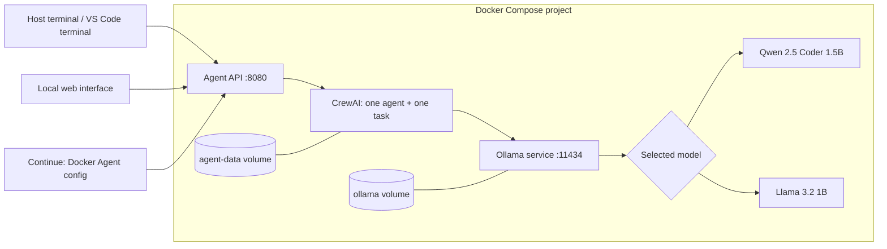

# Architecture

Only one model is selected per request. The branches are alternatives, not a pipeline between models. All inference runs on the local machine; no cloud LLM is configured.

## Interfaces

- `http://127.0.0.1:8080/`: local browser interface.
- `POST /chat`: terminal/API requests (`model` and `prompt`).
- `GET /health`: container service connectivity and installed model names.
- `/v1/chat/completions` and `/v1/models`: OpenAI-compatible adapter for Continue.
- Inside Docker, the agent resolves Ollama by the service name `ollama`, not `localhost`.
- The original Continue Independent config remains a separate direct-to-Ollama route. Use the Docker Agent config to demonstrate the full containerized agent route.

## Data and resources

The original named `ollama` volume retains the downloaded models. CrewAI writes runtime data to `agent-data`. Python libraries are installed in the image during build; runtime model downloads are unnecessary when both models are present. The application is serialized to avoid concurrent inference. Generated answers are not automatically verified as correct.

## Local versus disconnected

Local endpoint configuration does not alone prove disconnected operation. A separate override uses an internal Docker network to deny container external routing. The student should additionally disconnect the host internet and record a fresh request for the instructor's unplugged demonstration.
